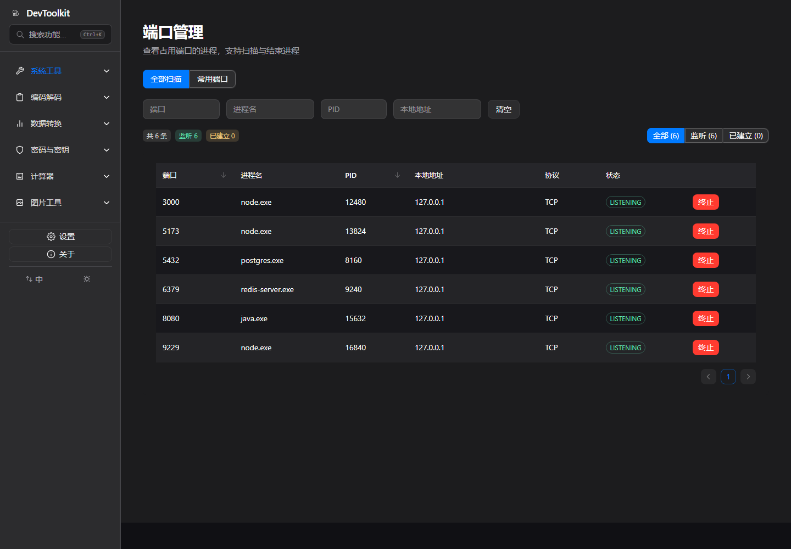
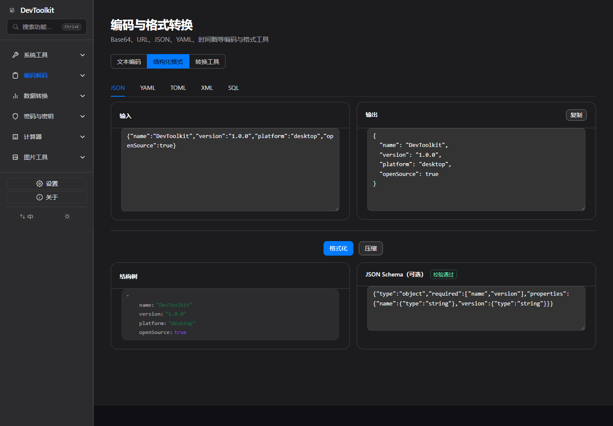
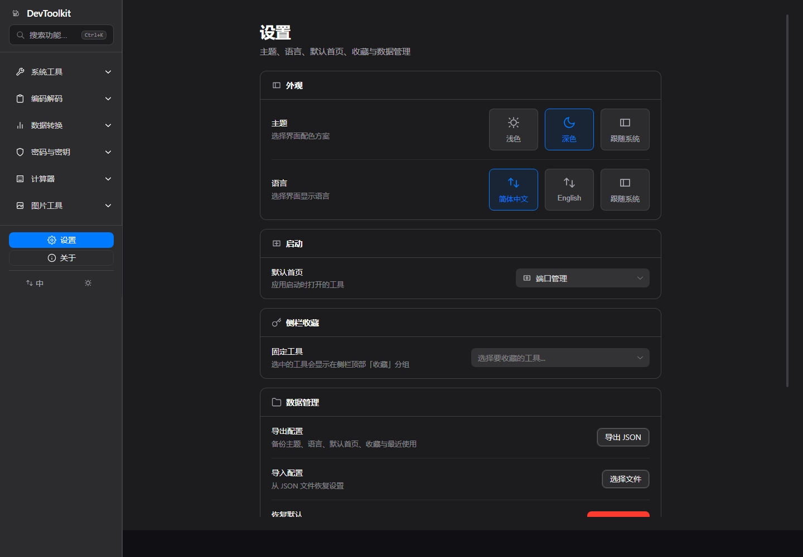

# Dev Tool Kit

本地优先的桌面开发者工具箱，集成端口诊断、编码转换、文本处理、密码与密钥、图片处理等 23 个工具。输入内容在本机处理，提供中英文界面、全局搜索和深浅色主题。

[English](README_EN.md)

## 主要功能

| 分类       | 工具与能力                                                                                 |
| ---------- | ------------------------------------------------------------------------------------------ |
| 系统工具   | 端口管理与 EADDRINUSE 诊断、环境变量、Hosts 编辑、批量文件重命名、正则测试                 |
| 编码与文本 | Base64、URL、JSON / Schema、YAML、TOML、XML、SQL 等编码与格式转换，文本对比                |
| 数据工具   | 颜色转换、UUID、Mock 数据、HTTP 状态码、开发速查、二维码、数据库连接字符串解析与构建       |
| 密码与密钥 | 密码与词组口令生成、JWT 解码 / 签发 / 验签、文本与文件 Hash、证书解析、RSA / EC 密钥对生成 |
| 计算器     | Cron、IPv4 / IPv6 子网、Chmod 权限                                                         |
| 图片工具   | 压缩、裁剪、缩放、格式转换、Base64、EXIF、SVG 优化、取色、图标生成、批处理与图片对比       |

**端口诊断**支持粘贴 TCP `EADDRINUSE` 报错或输入端口号，定位监听进程；确认终止前核对进程身份，操作后自动复查端口是否可以绑定。

使用 `Ctrl+K` 搜索工具；macOS 使用 `Command+K`。设置页可配置收藏、默认首页、语言和主题，完整快捷键见应用内「关于」。

## 界面预览



<details>
<summary>更多截图</summary>




</details>

端口列表与 JSON 内容使用演示数据。

## 安装与平台说明

Windows 打包格式为 NSIS，macOS 为 DMG，Linux 为 AppImage。

- Windows / macOS 安装包未签名，macOS 应用未经公证，系统可能提示未知发布者或阻止打开；请核对下载来源。
- Linux AppImage 需先赋予执行权限，例如 `chmod +x DevToolkit-*.AppImage`。
- 端口终止操作需要核实进程身份与权限。Windows 强制结束所选进程，macOS / Linux 发送终止信号，需系统 Python 3 和相应内核接口；无法核实身份的进程只供查看。端口可用状态以复查时刻为准。
- Windows 系统环境变量写入需要管理员权限，导入和恢复只处理用户变量；macOS / Linux 的修改写入所选用户 Shell 配置。Hosts 写入与 DNS 刷新也受系统权限限制。

CI 包含 Windows Electron 桌面回归。macOS / Linux 的系统命令、权限及文件操作仍需在目标系统验证。

## 本地开发

技术栈为 Electron、Vue 3、TypeScript、Naive UI 和 Vite。使用 Node.js 24.x、pnpm 9.0.0，在仓库根目录运行以下命令。

```bash
pnpm install --frozen-lockfile
pnpm dev
```

| 命令            | 用途                                                    |
| --------------- | ------------------------------------------------------- |
| `pnpm build`    | 编译共享包和桌面应用，桌面产物位于 `apps/desktop/out/`  |
| `pnpm dist`     | 构建当前平台的未签名安装包，输出至 `apps/desktop/dist/` |
| `pnpm dist:dir` | 生成解压目录形式的应用                                  |

安装依赖、下载应用和打开外部链接需要网络连接。

<details>
<summary>检查与发布</summary>

```bash
pnpm format:check
pnpm lint
pnpm typecheck
pnpm test:coverage
pnpm check:locales
pnpm build
pnpm test:desktop
```

桌面回归需要图形环境，使用隔离配置与临时数据。

发布前同步根目录、`apps/desktop`、`packages/shared` 的包版本，再推送匹配的 `v*` 标签或手动运行 Release 工作流。流程见 [CI](.github/workflows/ci.yml) 与 [Release](.github/workflows/release.yml)。

</details>

## 许可证

[MIT](LICENSE)
