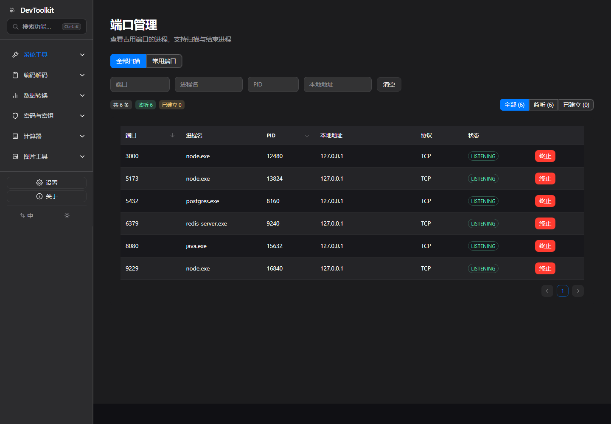
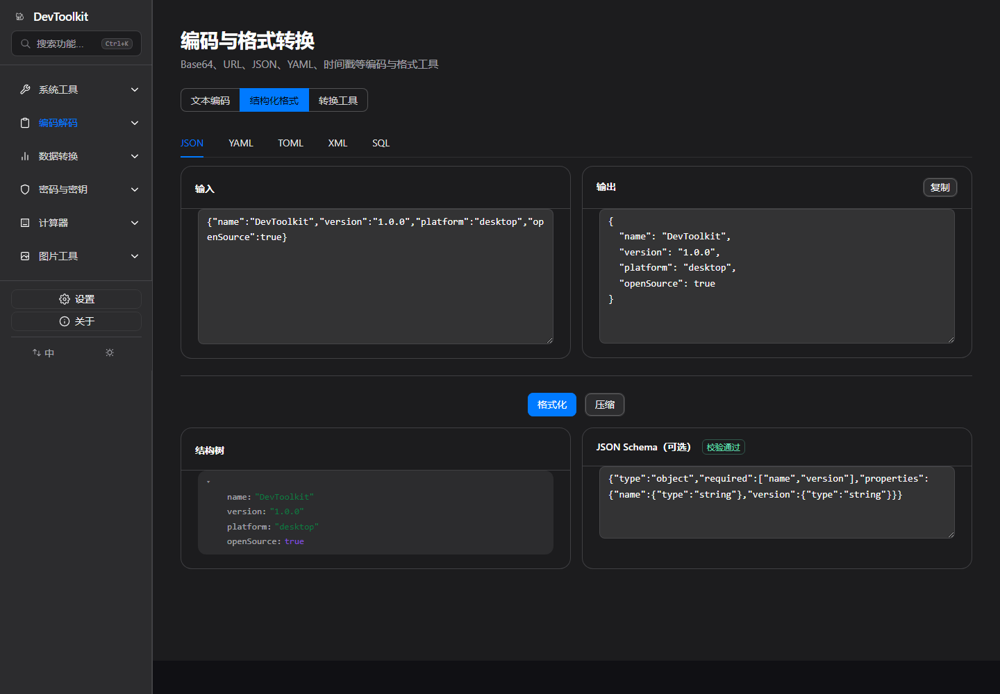
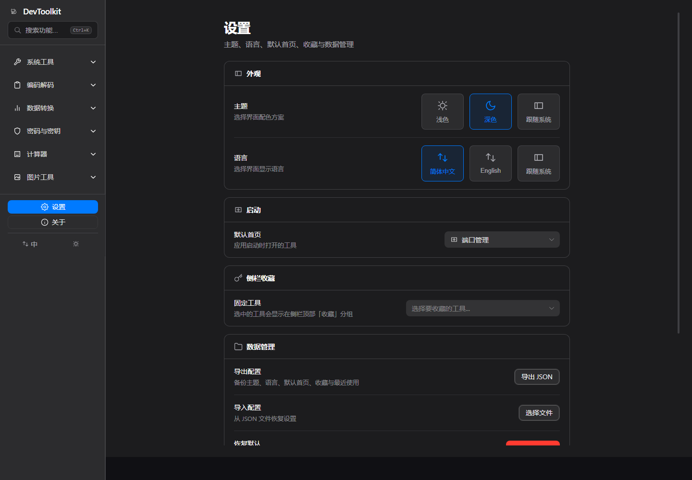

# Dev Tool Kit

<p align="center">
  <strong>小而美 · 本地优先 · 开发者工具箱</strong>
</p>

<p align="center">
  一款追求极简与优雅的桌面开发者工具集，灵感源于 Apple 设计哲学
</p>

<p align="center">
  中文文档 | <a href="README_EN.md">English Documentation</a>
</p>

## 界面预览

以下为代表性界面截图（端口管理、编码转换、设置）。应用内共 **23 个工具**，完整列表见下方 [功能概览](#功能概览)。

截图基于当前构建生成，端口列表与 JSON 内容为演示数据；文档网站另提供中英文、深浅色版本。





## 设计理念

**小而美** — 每个工具页面专注做好一件事；通过搜索与聚合入口避免重复，侧栏保持清晰。

**本地优先** — 工具在本机处理输入，不需要将内容上传到远程服务。安装依赖、下载安装包和打开外部链接需要网络连接。

**优雅体验** — 参考 Apple Human Interface Guidelines，追求简洁的界面、流畅的动画、直觉的操作。

**语言支持** — 提供中文和英文界面，可在应用内切换。

## 功能概览

### 系统工具

| 工具       | 说明                                                                                                                 |
| ---------- | -------------------------------------------------------------------------------------------------------------------- |
| 端口管理   | 本地端口扫描、常用端口、进程终止（Windows 完整支持；macOS/Linux 可终止用户进程，失败时复制 sudo 命令）               |
| 环境变量   | Windows 用户/系统变量读写、PATH、备份与导入导出；macOS/Linux 读取并写入 Shell 配置（显示目标文件、备份 + diff 预览） |
| Hosts 编辑 | hosts 可视化管理、分组、方案 diff、导入导出、DNS 刷新（Linux 多工具回退）；无写权限时禁用保存并一键复制 sudo 命令    |
| 文件重命名 | 批量重命名、规则链、正则替换、撤销、规则库、冲突预览                                                                 |
| 正则测试   | 正则匹配、替换预览（支持 flags）、常用表达式库                                                                       |

### 编码解码

| 工具           | 说明                                                                                                     |
| -------------- | -------------------------------------------------------------------------------------------------------- |
| 编码与格式转换 | Base64、URL、JSON（树形 + Schema）、YAML、TOML、XML、SQL、时间戳、进制、命名、HTML（统一入口，Tab 记忆） |
| 文本对比       | 逐行/逐词 Diff，文件导入，忽略空白/大小写，统一/并排视图                                                 |

### 数据转换

| 工具           | 说明                                                                                                  |
| -------------- | ----------------------------------------------------------------------------------------------------- |
| 颜色转换       | HEX、RGB、HSL、HSV 互转，WCAG 对比度检测                                                              |
| UUID 生成      | 批量生成 UUID/GUID                                                                                    |
| Mock 数据      | 预设模板、丰富字段类型、按字段生成 JSON、导出 JSON/CSV/SQL INSERT                                     |
| HTTP 状态码    | 62 个常用状态码速查、搜索与分类                                                                       |
| 开发速查       | MIME 类型、Git 命令模板、HTTP 方法离线速查（Tab 深链）                                                |
| 二维码生成     | 文本/URL 本地生成二维码，可调尺寸与纠错级别                                                           |
| 连接字符串解析 | MySQL、PostgreSQL、Redis、MongoDB URI **解析与构建**，字段表与 JSON 导出；可跳转 Mock 数据 / 端口管理 |

### 密码与密钥

| 工具       | 说明                                                              |
| ---------- | ----------------------------------------------------------------- |
| 密码生成   | 随机字符密码与离线词组口令（Diceware）                            |
| JWT 工具   | Secret 生成、Token 解码/签发、HMAC 与 RSA 公钥验签                |
| Hash 生成  | MD5、SHA-1、SHA-256、SHA-512；文本与文件哈希                      |
| 证书解析   | PEM/X.509 证书本地解析，查看主题、颁发者、有效期、指纹等          |
| 密钥对生成 | RSA 2048/4096、EC P-256/P-384 本地生成，PEM 导出，可跳转 JWT 验签 |

### 计算器

| 工具       | 说明                                                       |
| ---------- | ---------------------------------------------------------- |
| Cron 解析  | 可视化字段编辑、本地时区、接下来 5 次执行时间与相对倒计时  |
| 子网计算   | IPv4/IPv6 CIDR，VLSM 子网拆分，输出网络/广播/掩码/主机范围 |
| Chmod 计算 | 八进制/符号权限互转，rwx 位可视化                          |

### 图片工具

| 工具     | 说明                                                                                                                                                                           |
| -------- | ------------------------------------------------------------------------------------------------------------------------------------------------------------------------------ |
| 图片工具 | Base64 互转、信息与 EXIF、压缩、尺寸调整与裁剪、格式转换、Data URL、SVG 优化、取色与调色板、网站图标生成、批处理、图片对比（并排/滑块/差异叠加）、转码预设（Web/头像/电商/OG） |

## 快捷操作

### 全局

- `Ctrl+K` — 打开/关闭全局搜索（支持深链到编码转换、开发速查等子 Tab）
- 搜索浮层：`↑` / `↓` 移动，`Enter` 打开，`Esc` 关闭

### 页面内

- `Ctrl+Shift+C` — 双栏工具页复制输出（Hash、编码转换等）
- `Ctrl+Enter` — 编码与格式转换页执行当前 Tab 主操作
- `R` — 端口管理页刷新扫描（非输入框聚焦时）

### 其他

- 侧栏底部 — 设置 / 关于、语言与主题切换
- 设置页 — 配置侧栏收藏、默认首页、语言、主题（浅色 · 深色 · 跟随系统）、配置导入导出

完整快捷键列表见应用内 **关于** 页。

macOS 上组合快捷键可使用 `Command` 替代 `Ctrl`。

## 平台能力矩阵

| 功能                 | Windows  | macOS    | Linux    | 说明                                                                  |
| -------------------- | -------- | -------- | -------- | --------------------------------------------------------------------- |
| 端口扫描             | 完整支持 | 完整支持 | 完整支持 | —                                                                     |
| 终止占用进程         | 完整支持 | 部分支持 | 部分支持 | Unix 下可终止用户进程；系统进程可能需 sudo                            |
| 环境变量管理         | 完整支持 | 部分支持 | 部分支持 | Unix 可写入 Shell 配置（自动备份）；Windows 写入注册表                |
| Hosts 编辑           | 部分支持 | 部分支持 | 部分支持 | 写入可能需管理员权限；Windows 提供管理员操作提示，Unix 提供 sudo 命令 |
| DNS 刷新             | 完整支持 | 完整支持 | 部分支持 | 可能需要提权；Linux 依赖 systemd-resolve / resolvectl / nscd          |
| 文件重命名           | 完整支持 | 完整支持 | 完整支持 | —                                                                     |
| 编码 / Hash / JWT 等 | 本地可用 | 本地可用 | 本地可用 | 本机处理；文件 Hash 在主进程流式计算，Schema 校验使用 Worker          |
| 图片工具             | 本地可用 | 本地可用 | 本地可用 | 本机处理，部分功能依赖 sharp 原生模块                                 |

矩阵描述实现范围，不代表所有权限和系统环境均已验证。CI 包含 Windows Electron 冒烟测试；macOS/Linux 的系统命令、权限和文件操作还需在目标系统验证。

Windows 系统环境变量写入需要管理员权限，导入和备份恢复只处理用户变量；macOS/Linux 系统变量只读，修改写入所选用户 Shell 配置。Hosts 保存成功但 DNS 刷新失败时会单独提示，无需重复保存。

## 深链路由

以下为应用内 Hash 路由，例如 `#/code-converter?tab=json`，不是操作系统 URL 协议。简写路径重定向到当前工具页及对应 Tab，不代表独立工具实现。

| 路径                        | 目标                                                                                                                                              |
| --------------------------- | ------------------------------------------------------------------------------------------------------------------------------------------------- |
| `/code-converter`           | 编码与格式转换（例如 `?tab=json`、`base64`、`yaml`）                                                                                              |
| `/base64`                   | 编码转换 · Base64 Tab                                                                                                                             |
| `/url`                      | 编码转换 · URL Tab                                                                                                                                |
| `/yaml`                     | 编码转换 · YAML Tab                                                                                                                               |
| `/toml`                     | 编码转换 · TOML Tab                                                                                                                               |
| `/json-formatter`           | 编码转换 · JSON Tab                                                                                                                               |
| `/timestamp`                | 编码转换 · 时间戳 Tab                                                                                                                             |
| `/xml`                      | 编码转换 · XML Tab                                                                                                                                |
| `/sql`                      | 编码转换 · SQL Tab                                                                                                                                |
| `/image-base64`             | 图片工具 · Base64 Tab                                                                                                                             |
| `/image-tools`              | 图片工具（`?tab=base64` / `info` / `compress` / `resize` / `convert` / `dataUrl` / `svg` / `color` / `favicon` / `batch` / `compare` / `preset`） |
| `/chmod-calculator`         | Chmod 计算器                                                                                                                                      |
| `/http-status-codes`        | HTTP 状态码速查                                                                                                                                   |
| `/connection-string-parser` | 连接字符串解析与构建                                                                                                                              |
| `/dev-reference`            | 开发速查（`?tab=mime` / `git` / `http-methods`）                                                                                                  |
| `/key-pair-generator`       | RSA/EC 密钥对生成                                                                                                                                 |
| `/certificate-parser`       | 证书 PEM 解析                                                                                                                                     |
| `/qr-code-generator`        | 二维码生成                                                                                                                                        |

## 技术栈

- **Electron** — 跨平台桌面应用框架
- **Vue 3** — 渐进式 JavaScript 框架
- **Naive UI** — Vue 3 组件库
- **TypeScript** — 类型安全的 JavaScript 超集
- **Vite** — 下一代前端构建工具

## 快速开始

### 环境要求

- Node.js 24.x（与 CI 一致）
- pnpm 9.0.0

### 安装依赖

```bash
pnpm install --frozen-lockfile
```

### 开发模式

```bash
pnpm dev
```

### 构建应用

生产构建（编译共享包和桌面应用，桌面产物位于 `apps/desktop/out`，不生成安装包）：

```bash
pnpm build
```

### 构建安装包

在本地打包当前平台的未签名安装包（需先安装依赖）：

```bash
pnpm install --frozen-lockfile
pnpm dist          # 当前平台完整安装包（Windows NSIS / macOS DMG / Linux AppImage）
pnpm dist:dir      # 仅解压目录，用于快速验证打包配置
pnpm dist:win      # Windows 安装包，建议在 Windows 或对应 CI 中构建
pnpm dist:mac      # 仅 macOS（需在 macOS 上运行，或 CI 构建）
pnpm dist:linux    # 仅 Linux
```

产物输出至 `apps/desktop/dist/`。

**未签名发布说明：**

- **Windows** — 安装包未经代码签名，系统可能显示 SmartScreen 或「未知发布者」提示；确认安装包来源后按系统提示处理。
- **macOS** — 应用未签名、未经公证，系统可能阻止打开；确认安装包来源后按系统提示处理。
- **Linux** — AppImage 赋予执行权限后直接运行：`chmod +x DevToolkit-*.AppImage && ./DevToolkit-*.AppImage`

预编译安装包请前往 [GitHub Releases](https://github.com/blueWhalei/dev-tool-kit/releases) 下载。

### 发布新版本

先同步更新根目录、`apps/desktop` 和 `packages/shared` 的包版本；标签必须与三个包版本一致。Release 会先通过质量检查和 Windows 桌面冒烟，再构建三平台安装包（无需代码签名证书）：

```bash
git tag v1.0.0
git push origin v1.0.0
```

也可在 GitHub Actions 中手动运行 **Release** 工作流并填写完整标签（如 `v1.0.0`）。打包和发布都会校验构建提交；已存在的标签必须指向该提交，新标签显式指向构建提交。

### 代码检查

```bash
pnpm format:check
pnpm lint
pnpm typecheck
pnpm test:coverage
pnpm check:locales
```

`pnpm test` 仅运行测试；`test:coverage` 还生成 monorepo 覆盖率报告并检查关键文件门槛。`format:check` 检查脚本支持的已跟踪及未被忽略的新增文件，并遵循 `.prettierignore`；`pnpm format:changed` 格式化相对 HEAD 的变更。

`pnpm dev` 同时监听 shared 与桌面应用；只监听 shared 可运行 `pnpm --filter @dev-tool-kit/shared build:watch`。

桌面回归测试（需图形环境，先构建；使用隐藏窗口、独立临时配置与测试文件）：

```bash
pnpm build
pnpm test:desktop
```

## 项目结构

| 目录                        | 用途                               |
| --------------------------- | ---------------------------------- |
| `apps/desktop/src/main`     | 主进程、系统操作、文件处理及 IPC   |
| `apps/desktop/src/preload`  | 受限 IPC 桥接                      |
| `apps/desktop/src/renderer` | Vue 界面、路由与语言资源           |
| `packages/shared/src`       | 共享类型、IPC 契约、校验及计算工具 |
| `scripts`                   | 工程检查与桌面冒烟脚本             |
| `docs`                      | GitHub Pages 网站及深浅色截图      |
| `screenshots`               | README 使用的中英文截图            |

## 数据与资源边界

- 桌面主进程维护的 JSON 配置串行、原子写入，保留 `.bak` 恢复副本；主文件及备份均损坏时，基于读取的更新报错并保留原文件。界面偏好保存在 localStorage，可通过设置页导入导出。
- 图片单图选择限制为 64 MiB。差异比较画布最多 4,194,304 像素、单边最多 8,192 像素，超出时缩小并提示；这不等于原图解码的内存上限。
- 批量图片每窗口一个任务、每任务并发两张，结果暂存在主进程。取消停止排队项，处理中的项完成后保留结果；重试针对失败或取消项，保存跳过已有文件，退出面板或关闭窗口清理临时文件。

## 为什么选择 Dev Tool Kit？

- **无网络依赖** — 内网环境、断网状态，随时随地使用
- **数据隐私** — 所有数据本地处理，不上传任何信息
- **桌面集成** — 集成本机文件选择、端口扫描和系统配置操作
- **持续进化** — 更多实用工具持续加入中

## 许可证

[MIT](LICENSE)
