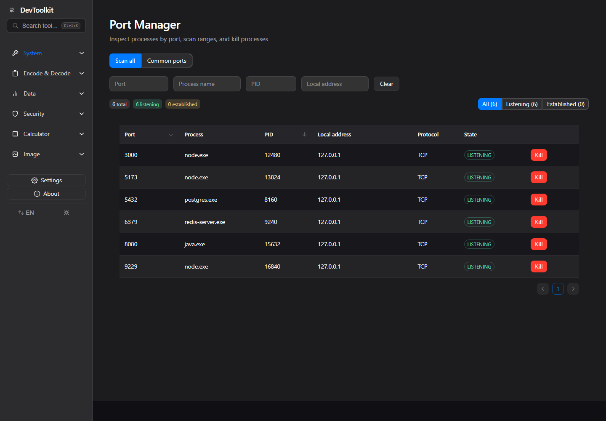
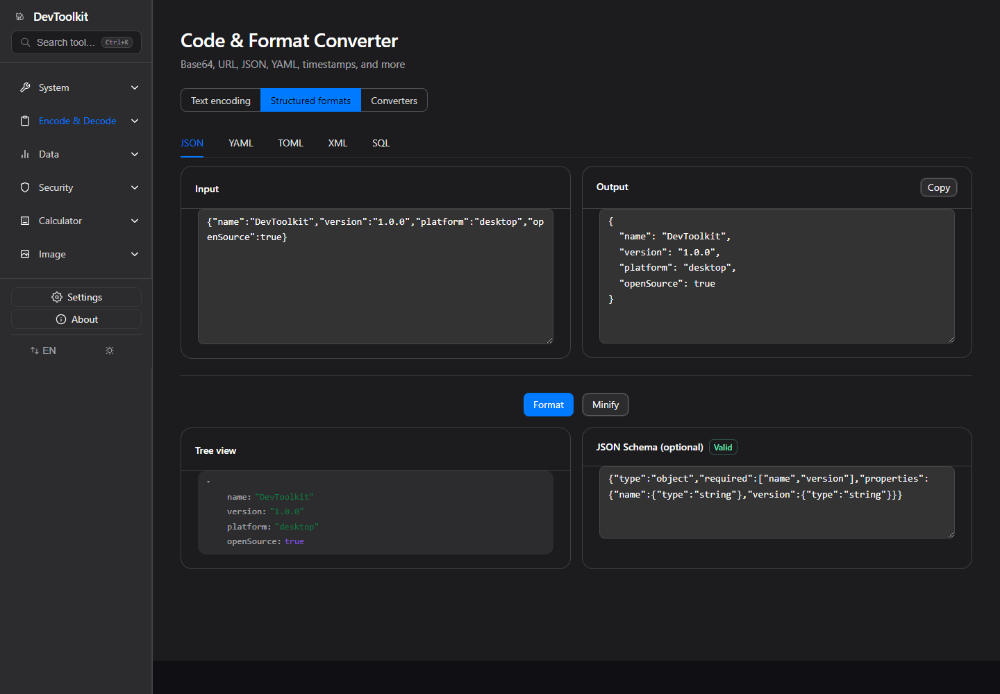
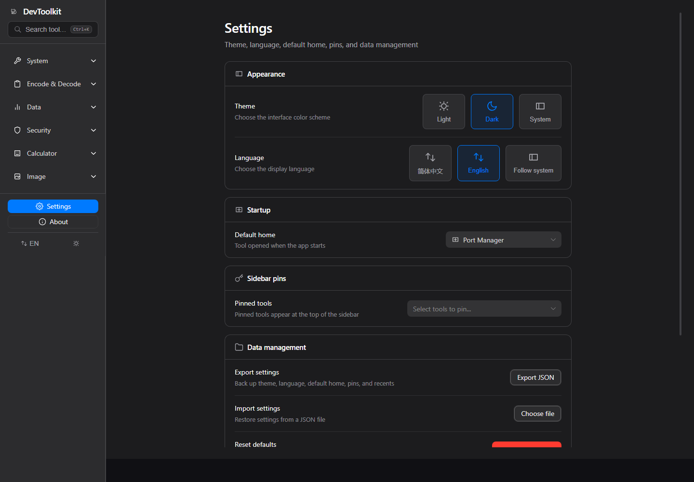

# Dev Tool Kit

<p align="center">
  <strong>Small & Beautiful · Local-First · Developer Toolkit</strong>
</p>

<p align="center">
  A desktop developer toolset pursuing minimalism and elegance, inspired by Apple's design philosophy
</p>

<p align="center">
  <a href="README.md">中文文档</a> | English Documentation
</p>

## Screenshots

Representative previews below (port manager, encoding converter, settings). The app includes **23 tools** in total — see [Features Overview](#features-overview) for the full list.

Screenshots use the current build with sample port and JSON data. The documentation website also includes Chinese/English and light/dark variants.





## Design Philosophy

**Small & Beautiful** — Each tool page focuses on doing one thing well; avoid duplication through search and aggregation entry, keep the sidebar clear.

**Local-First** — Tools process input on your device without sending it to a remote service. Installing dependencies, downloading installers, and opening external links require network access.

**Elegant Experience** — Following Apple Human Interface Guidelines, pursuing clean interfaces, smooth animations, and intuitive operations.

**Language Support** — Chinese and English interfaces, switchable within the app.

## Features Overview

### System Tools

| Tool                  | Description                                                                                                                                                  |
| --------------------- | ------------------------------------------------------------------------------------------------------------------------------------------------------------ |
| Port Manager          | Local port scanning, common ports, process termination (full on Windows; user processes on macOS/Linux; copy sudo command on failure)                        |
| Environment Variables | Windows user/system read-write, PATH, backup & export/import; macOS/Linux shell config write (shows target file, backup + diff preview)                      |
| Hosts Editor          | Visual hosts management, grouping, scheme diff, export/import, DNS flush (Linux multi-tool fallback); disable save without write access, one-click sudo copy |
| File Renamer          | Batch rename, rule chains, regex replace, undo, rule library, conflict preview                                                                               |
| Regex Tester          | Regex matching, replace preview with flags, common expression library                                                                                        |

### Encoding & Decoding

| Tool                         | Description                                                                                                             |
| ---------------------------- | ----------------------------------------------------------------------------------------------------------------------- |
| Encoding & Format Conversion | Base64, URL, JSON (tree + Schema), YAML, TOML, XML, SQL, timestamp, radix, naming, HTML (unified entry with Tab memory) |
| Text Diff                    | Line/word-level diff, file import, ignore whitespace/case, unified/split view                                           |

### Data Conversion

| Tool                     | Description                                                                                           |
| ------------------------ | ----------------------------------------------------------------------------------------------------- |
| Color Converter          | HEX, RGB, HSL, HSV conversion with WCAG contrast check                                                |
| UUID Generator           | Batch generate UUID/GUID                                                                              |
| Mock Data                | Preset templates, rich field types, field-based JSON generation, export JSON/CSV/SQL INSERT           |
| HTTP Status Codes        | Quick reference for 62 common status codes with search and categories                                 |
| Developer Reference      | Offline MIME types, Git command templates, HTTP methods (tab deep links)                              |
| QR Code Generator        | Generate QR codes locally from text/URL with adjustable size and error correction                     |
| Connection String Parser | Parse and build MySQL, PostgreSQL, Redis, MongoDB URIs; export JSON; link to Mock Data / Port Manager |

### Password & Keys

| Tool               | Description                                                                    |
| ------------------ | ------------------------------------------------------------------------------ |
| Password Generator | Random character passwords and offline passphrase (Diceware)                   |
| JWT Tool           | Secret generation, token decode/sign, HMAC & RSA public-key verification       |
| Hash Generator     | MD5, SHA-1, SHA-256, SHA-512; text and file hashing                            |
| Certificate Parser | Local PEM/X.509 parsing — subject, issuer, validity, fingerprints, and more    |
| Key Pair Generator | Local RSA 2048/4096 & EC P-256/P-384 key pairs, PEM export, link to JWT verify |

### Calculators

| Tool              | Description                                                                         |
| ----------------- | ----------------------------------------------------------------------------------- |
| Cron Parser       | Visual field editor, local timezone, next 5 execution times with relative countdown |
| Subnet Calculator | IPv4/IPv6 CIDR with VLSM splitting, network/broadcast/mask/host range               |
| Chmod Calculator  | Octal/symbolic permission conversion with rwx bit visualization                     |

### Image Tools

| Tool        | Description                                                                                                                                                                                                                                                     |
| ----------- | --------------------------------------------------------------------------------------------------------------------------------------------------------------------------------------------------------------------------------------------------------------- |
| Image Tools | Base64 conversion, info & EXIF, compress, resize & crop, format conversion, Data URL, SVG optimization, color picker & palette, favicon generator, batch process, image compare (side-by-side/slider/diff overlay), encoding presets (Web/Avatar/E-commerce/OG) |

## Keyboard Shortcuts

### Global

- `Ctrl+K` — Open/close global search (supports deep links to encoding conversion, developer reference tabs, etc.)
- Search overlay: `↑` / `↓` navigate, `Enter` open, `Esc` close

### In-Page

- `Ctrl+Shift+C` — Copy output in dual-panel tool pages (Hash, encoding conversion, etc.)
- `Ctrl+Enter` — Execute current tab's main action in encoding & format conversion page
- `R` — Refresh scan in port manager page (when not focused on input field)

### Others

- Sidebar bottom — Settings / About, language and theme controls
- Settings page — Sidebar favorites, default homepage, language, theme (Light · Dark · System), and configuration export/import

Full keyboard shortcuts list available in the app's **About** page.

On macOS, use `Command` in place of `Ctrl` for modifier shortcuts.

## Platform Capability Matrix

| Feature                    | Windows         | macOS           | Linux           | Notes                                                                                                     |
| -------------------------- | --------------- | --------------- | --------------- | --------------------------------------------------------------------------------------------------------- |
| Port Scanning              | Full Support    | Full Support    | Full Support    | —                                                                                                         |
| Kill Process               | Full Support    | Partial Support | Partial Support | Unix can kill user processes; system processes may need sudo                                              |
| Environment Variables      | Full Support    | Partial Support | Partial Support | Unix shell config write with backup; Windows registry write                                               |
| Hosts Editor               | Partial Support | Partial Support | Partial Support | May require elevated privileges; Windows provides administrator instructions, Unix provides sudo commands |
| DNS Flush                  | Full Support    | Full Support    | Partial Support | May require elevation; Linux uses systemd-resolve / resolvectl / nscd                                     |
| File Renamer               | Full Support    | Full Support    | Full Support    | —                                                                                                         |
| Encoding / Hash / JWT etc. | Local Available | Local Available | Local Available | Local processing; file hashing streams in the main process, Schema validation uses a Worker               |
| Image Tools                | Local Available | Local Available | Local Available | Local processing; some features depend on native sharp modules                                            |

This matrix describes implemented capabilities, not verification of every system and permission configuration. CI includes a Windows Electron smoke test; macOS/Linux commands, permissions, and file operations still need validation on the target OS.

Writing Windows system environment variables requires administrator privileges; imports and backup restoration affect user variables only. On macOS/Linux, system variables are read-only and edits target the selected user Shell configuration. If Hosts saving succeeds but DNS flushing fails, the app reports it separately without requiring another save.

## Deep Link Routes

These are in-app Hash routes, such as `#/code-converter?tab=json`, not an operating-system URL protocol. Short paths redirect to the current tool and tab rather than separate tool implementations.

| Path                        | Target                                                                                                                                              |
| --------------------------- | --------------------------------------------------------------------------------------------------------------------------------------------------- |
| `/code-converter`           | Code & Format Converter (for example, `?tab=json`, `base64`, or `yaml`)                                                                             |
| `/base64`                   | Encoding Conversion · Base64 Tab                                                                                                                    |
| `/url`                      | Encoding Conversion · URL Tab                                                                                                                       |
| `/yaml`                     | Encoding Conversion · YAML Tab                                                                                                                      |
| `/toml`                     | Encoding Conversion · TOML Tab                                                                                                                      |
| `/json-formatter`           | Encoding Conversion · JSON Tab                                                                                                                      |
| `/timestamp`                | Encoding Conversion · Timestamp Tab                                                                                                                 |
| `/xml`                      | Encoding Conversion · XML Tab                                                                                                                       |
| `/sql`                      | Encoding Conversion · SQL Tab                                                                                                                       |
| `/image-base64`             | Image Tools · Base64 Tab                                                                                                                            |
| `/image-tools`              | Image Tools (`?tab=base64` / `info` / `compress` / `resize` / `convert` / `dataUrl` / `svg` / `color` / `favicon` / `batch` / `compare` / `preset`) |
| `/chmod-calculator`         | Chmod Calculator                                                                                                                                    |
| `/http-status-codes`        | HTTP Status Codes Reference                                                                                                                         |
| `/connection-string-parser` | Connection string parse & build                                                                                                                     |
| `/dev-reference`            | Developer Reference (`?tab=mime` / `git` / `http-methods`)                                                                                          |
| `/key-pair-generator`       | RSA/EC Key Pair Generator                                                                                                                           |
| `/certificate-parser`       | Certificate PEM Parser                                                                                                                              |
| `/qr-code-generator`        | QR Code Generator                                                                                                                                   |

## Tech Stack

- **Electron** — Cross-platform desktop application framework
- **Vue 3** — Progressive JavaScript framework
- **Naive UI** — Vue 3 component library
- **TypeScript** — Type-safe JavaScript superset
- **Vite** — Next-generation frontend build tool

## Quick Start

### Prerequisites

- Node.js 24.x (same as CI)
- pnpm 9.0.0

### Install Dependencies

```bash
pnpm install --frozen-lockfile
```

### Development Mode

```bash
pnpm dev
```

### Build Application

Production build (compiles shared and desktop packages; desktop output goes to `apps/desktop/out`, without an installer):

```bash
pnpm build
```

### Building Installers

Package unsigned installers for the current platform locally (install dependencies first):

```bash
pnpm install --frozen-lockfile
pnpm dist          # Full installer for current OS (Windows NSIS / macOS DMG / Linux AppImage)
pnpm dist:dir      # Unpacked directory only — quick packaging smoke test
pnpm dist:win      # Windows installer; use Windows or the corresponding CI job
pnpm dist:mac      # macOS only (requires macOS host, or use CI)
pnpm dist:linux    # Linux only
```

Artifacts are written to `apps/desktop/dist/`.

**Unsigned release notes:**

- **Windows** — Installers are not code-signed. SmartScreen or unknown-publisher warnings may appear; verify the installer source before following the system prompts.
- **macOS** — The app is unsigned and not notarized, so the system may block opening it. Verify the installer source before following the system prompts.
- **Linux** — Make the AppImage executable and run: `chmod +x DevToolkit-*.AppImage && ./DevToolkit-*.AppImage`

Pre-built installers are available on [GitHub Releases](https://github.com/blueWhalei/dev-tool-kit/releases).

### Cutting a Release

Update the root, desktop and shared package versions together. The release tag must match all three versions. Release runs quality checks and the Windows desktop smoke test before building installers for all three platforms:

```bash
git tag v1.0.0
git push origin v1.0.0
```

You can also run **Release** manually from GitHub Actions and provide the full version tag, such as `v1.0.0`. Packaging and publishing verify the build commit: an existing tag must point to that commit, and a new tag explicitly targets it.

### Code Quality

```bash
pnpm format:check
pnpm lint
pnpm typecheck
pnpm test:coverage
pnpm check:locales
```

`pnpm test` runs tests only; `test:coverage` also reports monorepo coverage and enforces critical-file thresholds. `format:check` checks supported tracked and non-ignored new files, respecting `.prettierignore`; `pnpm format:changed` formats changes against HEAD.

`pnpm dev` watches shared and desktop code. Run `pnpm --filter @dev-tool-kit/shared build:watch` to watch shared alone.

Desktop regression smoke test (requires a graphical session; build first; uses a hidden window and isolated temporary data):

```bash
pnpm build
pnpm test:desktop
```

## Project Structure

| Directory                   | Purpose                                                   |
| --------------------------- | --------------------------------------------------------- |
| `apps/desktop/src/main`     | Main process, system operations, file processing, and IPC |
| `apps/desktop/src/preload`  | Restricted IPC bridge                                     |
| `apps/desktop/src/renderer` | Vue interface, routes, and localization                   |
| `packages/shared/src`       | Shared types, IPC contracts, validation, and utilities    |
| `scripts`                   | Engineering checks and desktop smoke scripts              |
| `docs`                      | GitHub Pages website and theme-specific screenshots       |
| `screenshots`               | Chinese and English README screenshots                    |

## Data and Resource Limits

- Main-process JSON configuration writes are serialized and atomic, with a `.bak` recovery copy. If both files are corrupt, read-modify-write operations fail while preserving the files. Interface preferences use localStorage and can be imported/exported in Settings.
- Single-image selection is limited to 64 MiB. Difference comparison uses at most 4,194,304 pixels and 8,192 pixels per edge, downscaling with a notice when necessary. These limits do not bound original-image decoding memory.
- Image batches allow one task per window and two concurrent images, with temporary results in the main process. Cancellation stops queued items while active ones finish. Retry processes failed or canceled items, saving skips existing files, and leaving the panel or closing the window cleans up temporary files.

## Why Choose Dev Tool Kit?

- **No Network Dependency** — Works in intranet environments, offline state, anytime anywhere
- **Data Privacy** — All data processed locally, no information uploaded
- **Desktop Integration** — Local file selection, port scanning, and system configuration tools
- **Continuous Evolution** — More practical tools continuously being added

## License

[MIT](LICENSE)
