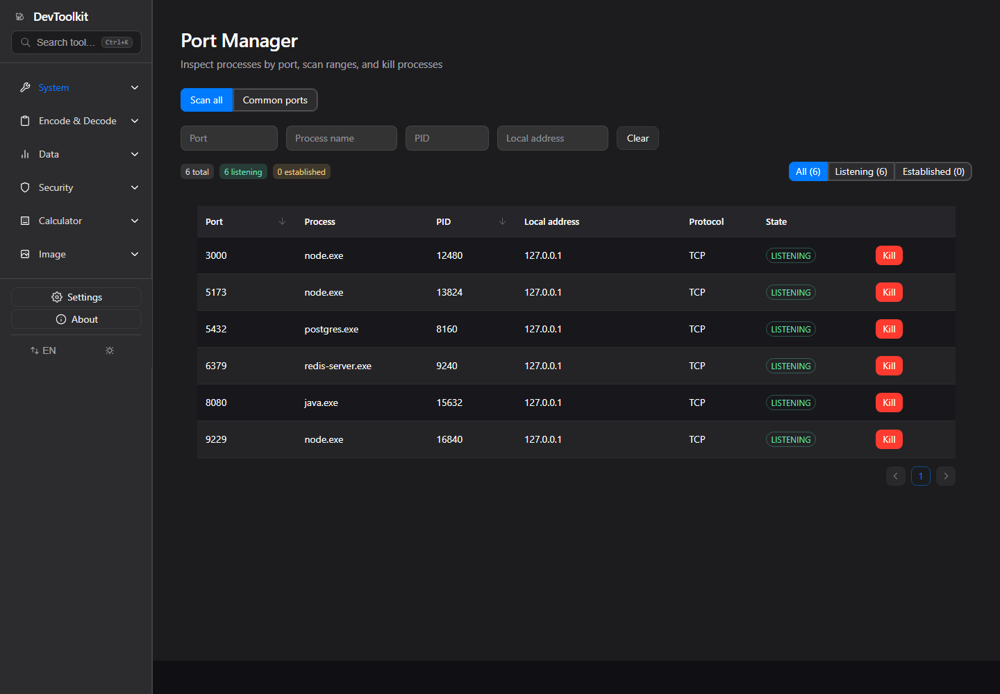
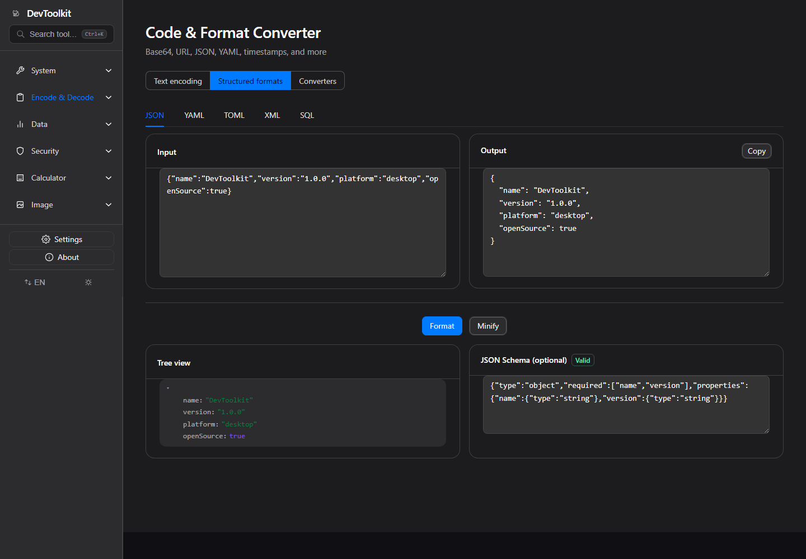
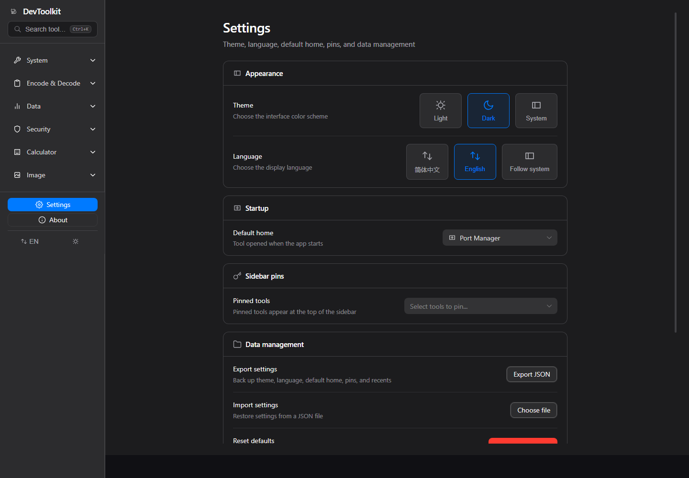

# Dev Tool Kit

A local-first desktop toolkit with 23 tools for port diagnostics, encoding, text, passwords and keys, image processing, and more. Inputs are processed on your device, with Chinese and English interfaces, global search, and light and dark themes.

[中文](README.md)

## Features

| Category         | Tools and capabilities                                                                                                                        |
| ---------------- | --------------------------------------------------------------------------------------------------------------------------------------------- |
| System           | Port management and EADDRINUSE diagnostics, environment variables, Hosts editing, batch file renaming, regex testing                          |
| Encoding & text  | Base64, URL, JSON / Schema, YAML, TOML, XML, SQL, and other format conversions; text comparison                                               |
| Data             | Color conversion, UUIDs, mock data, HTTP status codes, developer reference, QR codes, database connection string parsing and building         |
| Passwords & keys | Passwords and passphrases, JWT decoding / signing / verification, text and file hashes, certificate parsing, RSA / EC key pairs               |
| Calculators      | Cron, IPv4 / IPv6 subnets, Chmod permissions                                                                                                  |
| Images           | Compression, cropping, resizing, format conversion, Base64, EXIF, SVG optimization, color picking, favicons, batch processing, and comparison |

**Port diagnostics** accepts a TCP `EADDRINUSE` error or port number and identifies matching listeners. The app verifies process identity before a confirmed termination, then automatically checks whether the port can be bound.

Use `Ctrl+K` to find tools, or `Command+K` on macOS. Configure favorites, the default homepage, language, and theme in Settings. The full shortcut list is in the app's About page.

## Screenshots



<details>
<summary>More screenshots</summary>




</details>

Port lists and JSON content use sample data.

## Installation & platform notes

Windows packages use NSIS, macOS uses DMG, and Linux uses AppImage.

- Windows / macOS installers are unsigned, and the macOS app is not notarized. The system may show an unknown-publisher warning or block opening the app. Verify the download source.
- Linux AppImage files need execute permission, for example `chmod +x DevToolkit-*.AppImage`.
- Process termination requires verified identity and sufficient permissions. Windows forcibly stops the selected process. macOS / Linux send a termination signal and require system Python 3 and compatible kernel interfaces. Unverified processes are read-only. Port availability reflects the time of the check.
- Writing Windows system environment variables requires administrator privileges; imports and restoration affect user variables only. On macOS / Linux, edits target the selected user Shell configuration. Hosts writes and DNS flushing also depend on system permissions.

CI includes Windows Electron regression tests. System commands, permissions, and file operations on macOS / Linux still require validation on the target OS.

## Local development

Built with Electron, Vue 3, TypeScript, Naive UI, and Vite. Use Node.js 24.x and pnpm 9.0.0, then run these commands from the repository root.

```bash
pnpm install --frozen-lockfile
pnpm dev
```

| Command         | Purpose                                                                         |
| --------------- | ------------------------------------------------------------------------------- |
| `pnpm build`    | Compile shared and desktop packages; desktop output goes to `apps/desktop/out/` |
| `pnpm dist`     | Build unsigned installers for the current platform in `apps/desktop/dist/`      |
| `pnpm dist:dir` | Generate an unpacked application directory                                      |

Installing dependencies, downloading the app, and opening external links require network access.

<details>
<summary>Checks & releases</summary>

```bash
pnpm format:check
pnpm lint
pnpm typecheck
pnpm test:coverage
pnpm check:locales
pnpm build
pnpm test:desktop
```

Desktop regression tests require a graphical session and use isolated configuration and temporary data.

Before releasing, synchronize versions in the root, `apps/desktop`, and `packages/shared` packages. Push a matching `v*` tag or run the Release workflow manually. See the [CI](.github/workflows/ci.yml) and [Release](.github/workflows/release.yml) workflows.

</details>

## License

[MIT](LICENSE)
